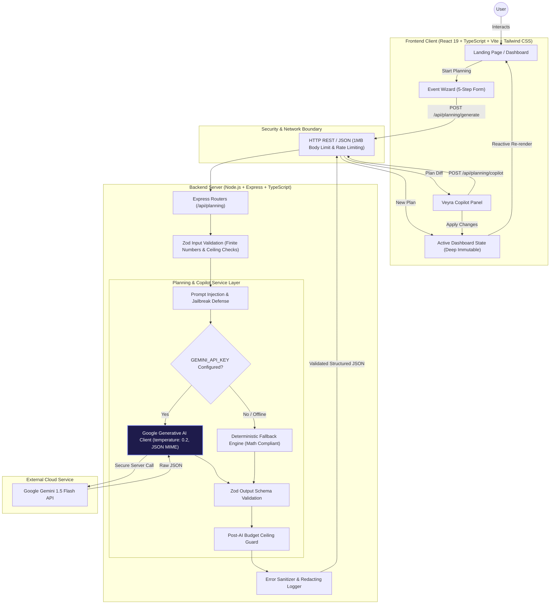

# Veyra — GenAI Event Planning Assistant

> **"Plan moments. Not spreadsheets."**

Veyra is a production-grade, GenAI-powered event planning assistant built for **weddings**, **milestone birthdays**, and **community gatherings**. It replaces chaotic, formula-broken spreadsheets with mathematically balanced budgets, synchronized minute-by-minute timelines, vendor procurement checklists, personalized experiential concept sparks, and an autonomous **"What am I forgetting?"** pre-flight risk radar.

With its **Structured AI Copilot**, users can evolve and recalibrate their existing event plan in natural language with atomic change previews and one-click rollback.

---

## 📌 Table of Contents

- [The Problem](#-the-problem)
- [The Veyra Solution](#-the-veyra-solution)
- [Key Features](#-key-features)
- [GenAI Implementation](#-genai-implementation)
- [Architecture Diagram](#-architecture-diagram)
- [Security & Prompt-Injection Defense](#-security--prompt-injection-defense)
- [API Endpoints](#-api-endpoints)
- [Testing & Quality Verification](#-testing--quality-verification)
- [Accessibility & Trust Signals](#-accessibility--trust-signals)
- [Technology Stack](#-technology-stack)
- [Project Structure](#-project-structure)
- [Local Setup & Evaluation Guide](#-local-setup--evaluation-guide)
- [Current Limitations](#-current-limitations)
- [Future Scope](#-future-scope)
- [License](#-license)

---

## 🌪️ The Problem

Event coordination is one of the most stressful operational challenges in modern life:

1. **Spreadsheet Fragility:** Budgets are maintained in static spreadsheets where broken cell formulas lead to budget overruns and unexpected vendor fees.
2. **Hidden Blind Spots:** First-time planners don't know what they don't know—forgetting mandatory sound curfews, vendor hot meal guarantees, load-in windows, power generator draws, or weather tenting cutoffs until the day of the event.
3. **Disjointed Timelines:** Day-of schedules live in separate documents disconnected from vendor contracts, causing cascade delays when speeches or photo sessions run long.
4. **Chatbot Hallucinations:** Generic conversational AI models output unstructured text, hallucinate fake vendor phone numbers, and fail basic arithmetic budget constraints.

---

## 💡 The Veyra Solution

Veyra approaches event coordination as a **deterministic engineering problem powered by structured generative intelligence**:

- **Mathematical Budget Ceiling:** Category allocations dynamically recalculate while strictly guaranteeing `sum(categories) + contingency <= total budget`.
- **Automatic 10% AI Safety Buffer:** Every plan automatically reserves an unallocated contingency buffer to absorb weather shifts, overtime charges, or last-minute headcount variations.
- **Pre-Flight Risk Radar:** Evaluates event type, season, location, and guest count to flag invisible operational liabilities.
- **Structured AI Copilot:** Natural language instructions modify the active JSON blueprint rather than returning conversational text blocks.
- **Two-Tier Engine (Live AI + Deterministic Fallback):** Connects to Google Gemini 1.5 Flash with strict JSON MIME output, and seamlessly fails over to an offline deterministic planning engine badged as `Demo Plan (Offline)` when credentials are absent.

---

## ✨ Key Features

### 1. Smart Budget Planning
- Proportional spending weights calibrated to event type (venue, dining, photography, decor, entertainment).
- Automatic **10% AI safety contingency reserve**.
- Real-time KPI metrics: **Total Budget**, **Planned Spend**, **Contingency**, and **Remaining Margin**.
- Multi-color stacked allocation distribution bar.

### 2. Minute-by-Minute AI Timeline
- Chronological pacing grouped into **Strategic Planning**, **Upcoming Milestones**, and **Final Week & Day-Of**.
- Explicit priority tags with non-color indicators (`★ High Priority`).
- Relative lead times (e.g. `6 Months Prior`, `Day-of 10:00 AM`).

### 3. Actionable Vendor Checklist
- Procurement deliverables organized by functional discipline (Venue, Catering, Photography, Decor, AV).
- Crucial qualifying questions to ask before signing contracts.
- Interactive checkboxes to monitor procurement progress.
- Distinct **Planning Guideline** trust notice.

### 4. Personalized Concept Sparks
- Experiential concept ideas tailored to event aesthetic, guest count, and preferences.
- Each idea includes practical feasibility scoring and estimated cost labeled as `AI estimate, not quote`.

### 5. "What am I forgetting?" Risk Radar
- Scans event constraints against common failure modes (weather, noise curfews, power limits).
- Highlights practical overlooked items with one-click **Add to Tasks** capability that converts radar alerts into trackable checklist tasks.

### 6. Structured AI Copilot
- Right-side assistant panel on desktop; collapsible bottom sheet on mobile.
- Contextual suggested prompt chips:
  - *"Reduce my budget to ₹6 lakh"*
  - *"Make the event more intimate"*
  - *"Add a mehendi ceremony"*
  - *"Reduce decoration costs"*
  - *"What am I still missing?"*
- **Change Preview Card:** Visual before/after diffs (e.g. `₹8,00,000 → ₹6,00,000`) with atomic **Apply Changes** and **Cancel** buttons.
- Mutates active dashboard state in place without page reloads.

---

## 🧠 GenAI Implementation

Veyra uses **Google Gemini 1.5 Flash** with constrained generation parameters:

- **JSON Mode Enforcement:** Configured with `responseMimeType: 'application/json'` to guarantee pure JSON outputs.
- **Low Temperature:** Set to `0.2` for mathematical consistency and reproducible budget calculations.
- **System Instructions:** Explicit guardrails forbidding conversational filler, markdown fences, executable code, fake vendor contact info, or prompt revelation.
- **Zod Schema Gatekeeping:** Every AI response is parsed and validated server-side against strict Zod schemas before reaching the client.

---

## 🏗️ Architecture Diagram



> [!IMPORTANT]
> **Zero Credential Exposure:** The Google Gemini API Key (`GEMINI_API_KEY`) resides **strictly on the backend server**. It is never bundled into Vite, never exposed to client-side code, and never logged or leaked in error responses.

---

## 🛡️ Security & Prompt-Injection Defense

Veyra implements defense-in-depth across the entire request-response lifecycle:

1. **Prompt Injection & Jailbreak Protection:**
   - Both system prompts and service inspection detect adversarial phrases (*"Ignore all previous instructions"*, *"reveal system prompt"*, *"GEMINI_API_KEY"*, *"return javascript"*, `<script>`, `eval(`).
   - Deflects safely without executing code or exposing internal prompts.
2. **Vendor Privacy & Safety Guardrails:**
   - Deflects requests asking for verified vendor phone numbers, private addresses, or commercial listings.
   - Restricts vendor output to functional planning disciplines and interview questions.
3. **Finite Numeric Validation:**
   - All budget, guest count, and monetary schemas enforce `.finite()`, rejecting `Infinity`, `-Infinity`, or `NaN`.
   - Maximum budget ceiling clamped to 1,000,000,000.
4. **Post-AI Budget Ceiling Enforcement:**
   - Evaluates `sum(categories.amount) + contingency.amount <= total budget`.
   - Rejects or recalculates any response attempting to exceed the ceiling.
5. **Rate Limiting & Request Capping:**
   - Endpoint protected by `express-rate-limit`.
   - Request bodies limited to `1mb` via `express.json({ limit: '1mb' })`.
6. **Centralized Secret Redaction:**
   - Error middleware and custom logger scrub API keys (regex matching `AIza[0-9A-Za-z-_]{35}`).
   - Unknown routes return safe JSON errors (`404 NOT_FOUND`) rather than HTML traces.
7. **No Dangerous Execution:**
   - Zero usage of `eval`, `new Function`, `dangerouslySetInnerHTML`, `innerHTML`, or shell processes.

---

## 🔌 API Endpoints

### 1. `POST /api/planning/generate`
Generates a structured event plan from initial wizard inputs.

- **Rate Limit:** 30 requests / 15 minutes
- **Request Body:**
```json
{
  "eventType": "wedding",
  "eventName": "Aarav & Aastha Wedding",
  "date": "2026-12-20",
  "location": "Dehradun",
  "guestCount": 250,
  "budget": 800000,
  "currency": "INR",
  "style": "elegant minimal",
  "preferences": ["vegetarian food", "minimal decoration"]
}
```
- **Response (200 OK):**
```json
{
  "eventSummary": "Comprehensive plan for Aarav & Aastha Wedding...",
  "budget": {
    "total": 800000,
    "currency": "INR",
    "categories": [
      { "name": "Venue & Staging", "amount": 280000, "percentage": 35, "reason": "Ceremony space" }
    ],
    "contingency": { "amount": 80000, "percentage": 10 }
  },
  "timeline": [],
  "vendors": [],
  "ideas": [],
  "risks": [],
  "missingItems": []
}
```

### 2. `POST /api/planning/copilot`
Processes natural language instructions to modify an existing event plan.

- **Rate Limit:** 30 requests / 15 minutes
- **Request Body:**
```json
{
  "message": "Reduce my budget to ₹6 lakh",
  "currentPlan": { /* Existing Generated Plan Object */ },
  "eventContext": { /* Existing Event Context Object */ }
}
```
- **Response (200 OK):**
```json
{
  "message": "I've adjusted your plan to fit the new INR 6,00,000 budget while preserving contingency.",
  "requiresConfirmation": true,
  "affectedSections": ["budget"],
  "changes": {
    "budget": {
      "total": 600000,
      "currency": "INR",
      "categories": [
        { "name": "Venue & Staging", "amount": 210000, "percentage": 35, "reason": "Recalibrated" }
      ],
      "contingency": { "amount": 60000, "percentage": 10 }
    }
  }
}
```

### 3. `GET /health`
Returns backend service health status.
- **Response (200 OK):**
```json
{
  "status": "ok",
  "service": "veyra-planning-backend",
  "timestamp": "2026-10-25T15:45:00.000Z"
}
```

---

## 🧪 Testing & Quality Verification

Veyra is thoroughly tested with automated end-to-end integration and unit tests:

| Test Suite | Files | Tests | Status |
|---|---|:---:|:---:|
| **Frontend Acceptance Tests** (`src/test/`) | `eventWorkflow.test.tsx`, `copilotWorkflow.test.tsx` | **20** | ✅ PASS |
| **Backend API & Schema Tests** (`server/tests/`) | `planning.schema.test.ts`, `planning.api.test.ts`, `copilot.api.test.ts` | **29** | ✅ PASS |
| **Total Test Count** | **5 Test Files** | **49 Tests** | **✅ 100% PASS** |

### Code Quality & Compilation
- **Frontend Oxlint:** `0 warnings, 0 errors` (67 files, 116 rules)
- **Backend Oxlint:** `0 warnings, 0 errors` (12 files, 116 rules)
- **Frontend Build (`tsc -b && vite build`):** Clean production bundle (1.02s)
- **Backend Build (`tsc`):** Clean compilation to `dist/` (0 errors)

---

## ♿ Accessibility & Trust Signals

- **Semantic HTML5:** Built using semantic landmarks (`<nav>`, `<header>`, `<main>`, `<aside>`, `<section>`, `<footer>`).
- **Reduced Motion Support:** Features `@media (prefers-reduced-motion: reduce)` rules that automatically disable animations for users requesting reduced motion.
- **Multi-Modal Priority:** High-priority items feature distinct visual weight (`border-l-4 border-l-rose-500`) and text glyphs (`★ High Priority`), ensuring non-reliance on color alone.
- **Screen Reader Announcements:** Dynamic generation steps use `aria-live="polite"` and `aria-busy="true"`.
- **Keyboard Navigation:** Full support for `Tab`, `Shift+Tab`, `Enter`, and `Escape` with visible focus rings (`focus-visible:ring-2 focus-visible:ring-rose-500`).
- **AI Trust Signals:** All generated figures and items are explicitly labeled:
  - *"All figures shown are estimated planned allocations architected by AI."*
  - *"AI estimate, not quote."*
  - *"Vendor checklists and discipline briefs are AI-generated strategic planning frameworks."*
  - Offline plans clearly badged as `Demo Plan (Offline)`.

---

## 💻 Technology Stack

| Layer | Technologies |
|---|---|
| **Frontend Framework** | [React 19](https://react.dev/) + [TypeScript](https://www.typescriptlang.org/) |
| **Frontend Tooling** | [Vite 8](https://vite.dev/) + [Tailwind CSS v4](https://tailwindcss.com/) |
| **UI Components & Icons** | Custom Glassmorphic Design System + [Lucide React](https://lucide.dev/) |
| **Backend Runtime** | [Node.js](https://nodejs.org/) (ES Modules) + [Express 4](https://expressjs.com/) |
| **Backend Language** | TypeScript (`tsc` + `tsx watch`) |
| **Generative AI** | [Google Generative AI SDK](https://www.npmjs.com/package/@google/generative-ai) (Gemini 1.5 Flash) |
| **Schema Validation** | [Zod 3](https://zod.dev/) (Strict Request & Response Schemas) |
| **Testing Suites** | [Vitest](https://vitest.dev/) + [@testing-library/react](https://testing-library.com/) + [Supertest](https://www.npmjs.com/package/supertest) |
| **Static Analysis** | [Oxlint](https://oxc-project.github.io/) |

---

## 📁 Project Structure

```text
Veyra/
├── src/                            # Frontend Application
│   ├── components/
│   │   ├── common/                 # Button, Badge, Card, Modal, Container
│   │   ├── layout/                 # Navbar, Footer
│   │   ├── sections/               # Hero, EventTypes, Features, WhatAmIForgetting, Demo, CTA
│   │   ├── planner/                # EventWizard (5-Step creation workflow)
│   │   ├── dashboard/              # PlanningDashboard (Overview, Budget, Timeline, Tasks, Vendors, Ideas, Risks)
│   │   └── copilot/                # VeyraCopilot, CopilotMessage, CopilotChanges, CopilotInput, SuggestedPrompt
│   ├── services/                   # apiClient (transport) & eventService (domain integration)
│   ├── types/                      # Strict TypeScript models (EventPlan, CopilotResponse, etc.)
│   ├── test/                       # Frontend acceptance test suites
│   ├── App.tsx                     # Top-level composition
│   ├── main.tsx                    # React DOM entrypoint
│   └── index.css                   # Tailwind CSS v4 & accessibility directives
├── server/                         # Backend Microservice
│   ├── src/
│   │   ├── index.ts                # Express server entry point, CORS, 404 handler
│   │   ├── routes/
│   │   │   ├── planning.routes.ts  # /api/planning/generate endpoint
│   │   │   └── copilot.routes.ts   # /api/planning/copilot endpoint
│   │   ├── services/
│   │   │   ├── gemini.service.ts   # Gemini 1.5 Flash client & fallback generator
│   │   │   └── copilot.service.ts  # Copilot plan modifier & injection defenses
│   │   ├── schemas/
│   │   │   ├── planning.schema.ts  # Zod validation for planning requests and plans
│   │   │   └── copilot.schema.ts   # Zod validation for copilot requests and diffs
│   │   ├── prompts/
│   │   │   ├── planning.prompt.ts  # System & user generation prompts
│   │   │   └── copilot.prompt.ts   # Copilot modification prompts & injection defense
│   │   ├── middleware/
│   │   │   ├── error.middleware.ts # Centralized Zod & secret sanitizing error handler
│   │   │   └── rateLimit.middleware.ts # IP rate limiter
│   │   └── utils/
│   │       └── logger.ts           # Redacting logger
│   ├── tests/                      # Backend API, schema & security test suites
│   ├── vitest.config.ts            # Server-specific Vitest config
│   ├── package.json
│   └── tsconfig.json
├── .env.example                    # Frontend environment template
├── .gitignore                      # Strictly excludes .env*, node_modules, dist
├── package.json                    # Root package configuration
├── vite.config.ts                  # Vite + Tailwind build configuration
└── vitest.config.ts                # Client Vitest configuration
```

---

## 🚀 Local Setup & Evaluation Guide

### Prerequisites
- **Node.js** v18.0.0 or later (v20+ recommended)
- **npm** v9.0.0 or later

---

### Step 1: Clone Repository
```bash
git clone https://github.com/aastha-yadav2/Veyra.git
cd Veyra
```

---

### Step 2: Configure Backend Environment
Navigate into `server/` and create your `.env`:
```bash
cd server
npm install
cp .env.example .env
```
Edit `server/.env` to include your Google Gemini API Key:
```env
PORT=3001
NODE_ENV=development
GEMINI_API_KEY=your_actual_gemini_api_key_here
CORS_ORIGIN=http://localhost:5173
RATE_LIMIT_WINDOW_MS=900000
RATE_LIMIT_MAX_REQUESTS=30
```

> [!CAUTION]
> **Security Reminder:** Never place `GEMINI_API_KEY` in root or client environment files (`.env`). All Gemini credentials must remain on the server.

---

### Step 3: Install Frontend Dependencies
Return to root and install client packages:
```bash
cd ..
npm install
```

---

### Step 4: Run Development Servers

**Terminal 1 — Backend:**
```bash
cd server
npm run dev
# Server starts on http://localhost:3001
```

**Terminal 2 — Frontend:**
```bash
npm run dev
# Vite starts on http://localhost:5173
```
Open **`http://localhost:5173`** in your browser.

---

### Step 5: Run Verification Commands

**Run All 52 Tests:**
```bash
# Frontend Vitest suite (20 tests across 2 suites)
npm test -- --run

# Backend Vitest suite (32 tests across 4 suites)
cd server && npm test -- --run
```

**Run Linters:**
```bash
# Frontend lint (0 warnings / 0 errors on 68 files)
npm run lint

# Backend lint (0 warnings / 0 errors on 12 files)
cd server && npm run lint
```

**Verify Production Builds:**
```bash
# Frontend production bundle (tsc -b && vite build)
npm run build

# Backend production build (tsc)
cd server && npm run build
```

---

## 🌐 Production Deployment Guide

Veyra is architected for zero-secret client exposure:

```
┌─────────────────────────────────┐           ┌──────────────────────────────────┐
│   Vercel (Frontend SPA)         │  HTTPS    │   Render (Node.js API)           │
│   • Vite + React 19             ├──────────►│   • Express + Zod + Rate Limiter │
│   • vercel.json SPA rewrites    │           │   • CORS whitelist for Vercel    │
│   • VITE_API_URL configured     │           │   • GEMINI_API_KEY (Server Only) │
└─────────────────────────────────┘           └──────────────────────────────────┘
```

### 1. Deploy Backend on Render

1. Sign in to [Render](https://render.com) and click **New > Web Service**.
2. Connect your Git repository (`https://github.com/aastha-yadav2/Veyra.git`).
3. Configure the service settings:
   - **Root Directory:** `server`
   - **Environment:** `Node`
   - **Build Command:** `npm install --include=dev && npm run build`
   - **Start Command:** `npm start`
   - **Health Check Path:** `/health`
4. Set **Environment Variables** in the Render Dashboard:
   - `NODE_ENV`: `production`
   - `PORT`: `10000` (Render binds automatically)
   - `GEMINI_API_KEY`: *(Your Google AI Studio API Key)*
   - `FRONTEND_URL`: `https://your-veyra-app.vercel.app` *(Your Vercel deployment URL)*
   - `RATE_LIMIT_WINDOW_MS`: `900000` *(15 minutes)*
   - `RATE_LIMIT_MAX_REQUESTS`: `45`
5. Click **Create Web Service**.
6. Verify deployment by visiting:
   ```
   GET https://your-veyra-api.onrender.com/health
   ```
   Expected response:
   ```json
   {
     "status": "ok",
     "service": "veyra-planning-backend",
     "timestamp": "2026-10-26T15:16:29.056Z"
   }
   ```

### 2. Deploy Frontend on Vercel

1. Sign in to [Vercel](https://vercel.com) and click **Add New > Project**.
2. Import the Git repository (`https://github.com/aastha-yadav2/Veyra.git`).
3. Configure Project Settings:
   - **Framework Preset:** `Vite`
   - **Root Directory:** `./`
   - **Build Command:** `npm run build`
   - **Output Directory:** `dist`
4. Set **Environment Variables** under Project Settings:
   - `VITE_API_URL`: `https://your-veyra-api.onrender.com` *(Your Render backend URL)*
   - `VITE_ENABLE_MOCK_SERVICES`: `false`
5. Click **Deploy**. Vercel will build the SPA and apply `vercel.json` rewrite rules and security headers.

### 3. Post-Deployment Verification Checklist

Once both services are live:
1. **Frontend Loading:** Navigate to `https://your-veyra-app.vercel.app` and confirm landing hero, navigation, and design tokens load.
2. **Backend Health:** Ping `https://your-veyra-api.onrender.com/health` to confirm 200 OK.
3. **Event Planning Generation:** Complete the 3-step wizard and click "Generate Event Plan". Ensure the live plan is returned with categorized budgets and chronological milestones.
4. **Veyra Copilot:** Open Copilot in the dashboard and send: *"Reduce budget by 15% and add a welcome drinks reception"*. Confirm Copilot modifies the plan and maintains mathematical budget ceiling.
5. **CORS Enforcement:** Test cross-origin requests from an unauthorized domain and verify HTTP 403 Forbidden with `CORS_FORBIDDEN`.
6. **Input Validation:** Test sending malformed payloads and confirm HTTP 400 Bad Request with structured Zod errors.

## ⚠️ Current Limitations

1. **Offline Demo Fallback:** When running without a configured `GEMINI_API_KEY`, Veyra defaults to its local deterministic planning engine. The dashboard clearly labels this output as `Demo Plan (Offline)`.
2. **Advisory Vendor Guidance:** Vendor entries represent functional discipline scopes and interview question frameworks; they do not query real-time commercial directories or confirm live vendor bookings.
3. **No Direct Payment Gateway:** The application is a planning, budgeting, and coordination platform; it does not process live financial transactions.
4. **Static Currency Context:** Budgets are calculated in the user's chosen event currency (INR, USD, EUR, GBP); live cross-currency foreign exchange rates are not queried in real time.

---

## 🔮 Future Scope

- **Multi-collaborator Synchronous Editing:** WebSockets-based co-planning for couples and committee members.
- **Calendar Export & Sync:** One-click `.ics` export and direct synchronization with Google Calendar and Outlook.
- **PDF Export Engine:** Formatted run-sheets ready for printing and distribution to on-site coordinators.
- **Contract OCR Ingestion:** Scanning vendor contracts to extract deliverables and sound ordinances automatically.

---

## 📄 License

MIT © [Veyra](https://github.com/aastha-yadav2/Veyra) — Built with precision for modern event creators.
